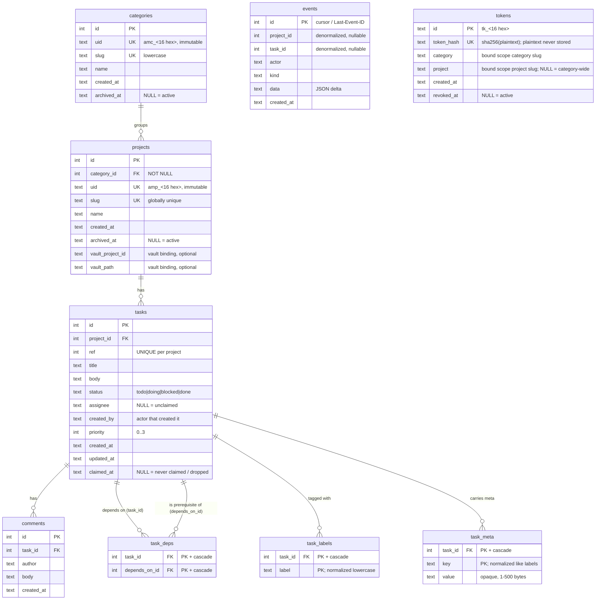

# Data Model

## Overview

Storage is a single **SQLite** database (default `~/.agentman/agentman.db`), WAL mode, owned by
one writer process. Schema is in `cmd/am/schema.sql` (embedded and executed at startup by
`store.OpenStore`). Ten tables: `meta`, `categories`, `projects`, `tasks`, `task_deps`,
`task_labels`, `task_meta`, `tokens`, `comments`, `events`.
All timestamps are ISO-8601 UTC **TEXT** (`strftime('%Y-%m-%dT%H:%M:%fZ','now')`), so they sort
lexically.

## Entities

| Entity | Purpose | Source |
|--------|---------|--------|
| `meta` | Key/value config: `schema_version` (always `1`) and `schema_hash` (the `schema.sql` the DB was made from); `OpenStore` refuses a mismatch of either — see [Schema](#schema) | `schema.sql` |
| `categories` | The layer above projects (`instance → category → project → task`): `uid` stable id, `slug` unique lowercase, `name`, `archived_at` | `schema.sql`, `store.go Category` |
| `projects` | Named boards (`slug` unique, `name`, `archived_at`, `category_id`, `uid` stable id, `vault_project_id`/`vault_path` binding) | `schema.sql`, `store.go Project` |
| `tasks` | Tickets (status, priority, assignee, dual id) | `schema.sql`, `store.go Task` |
| `task_deps` | Prerequisite edges between tasks (many-to-many, same-project only) | `schema.sql`, `store.go DepRef` |
| `task_labels` | Free-form tags on tasks (many-to-many, label text stored inline — no catalog) | `schema.sql`, `store.go Task.Labels` |
| `task_meta` | Free-form `key → value` pairs on tasks (values opaque; key PRESENCE is the filterable unit; no catalog) | `schema.sql`, `store.go Task.Meta` |
| `tokens` | Scope-bound bearer credentials (Phase S): stores only the **sha256 hash** of each token, never the plaintext | `schema.sql`, `store.go Token` |
| `comments` | Threaded notes on a task | `schema.sql`, `store.go Comment` |
| `events` | Append-only mutation log = activity feed + SSE backbone + cursor (rows removed only by the offline `am db prune`) | `schema.sql`, `store.go Event` |

### Important fields

- **`tasks.id`** — the cheap wire reference (`#42`). It is an `INTEGER PRIMARY KEY
  AUTOINCREMENT`, so a deleted task's id is never reissued (`projects.id` and `events.id`
  likewise). **`tasks.ref`** — per-project sequence (`web-3`), allocated as `MAX(ref)+1`
  within the project in the insert tx (`store.go CreateTask`); `UNIQUE(project_id, ref)`.
- **`tasks.created_by`** — TEXT NOT NULL, the actor that created the task (Phase Q, for the proposals
  carve-out: a scoped agent may comment on its OWN proposal tickets). Set on every new task from the
  request actor (`actorOf(r)`, default `"human"`; the store-level `actorOr` fallback `"anon"` is
  only reachable for direct store callers passing an empty actor). The column is nullable, but
  every create sets it; a NULL would simply never match the own-proposal comment rule (the safe
  direction). Returned as
  `created_by` on `GET /api/tasks/{id}` (omitted when empty); **deliberately NOT carried on list
  rows** — only the single-task read and the server's scope checks (`taskScope`) read it, keeping
  list payloads stable.
- **`tasks.status`** — `CHECK (status IN ('todo','doing','blocked','done'))`, default `todo`.
- **`tasks.priority`** — INTEGER, `0=urgent … 3=low`, default `2`.
- **`tasks.assignee`** — TEXT, **NULL = unclaimed** (the claim guard depends on this).
- **`tasks.claimed_at`** — TEXT, **NULL = never claimed / dropped**; set by `ClaimTask`,
  `StealStaleClaim`, `NextTask`, and PATCH-assign; cleared when the assignee is removed (`am drop`).
  Staleness itself is judged from
  `updated_at` (any activity counts), not `claimed_at`; the stale cutoff is computed in Go by
  `staleCutoff`, which must keep the exact `strftime('%Y-%m-%dT%H:%M:%fZ')` 3-digit-fraction
  format for the lexicographic comparison to hold.
- **`task_deps.(task_id, depends_on_id)`** — composite PK on the pair. Both columns are FKs to
  `tasks.id` with `ON DELETE CASCADE`, so removing a task automatically removes all edges in both
  directions. A reverse index `idx_task_deps_prereq(depends_on_id)` supports the "blocks" query.
  Dependencies are **same-project only** (validated in `AddDep`; cross-project attempt → 400).
  Cycle detection uses a recursive CTE (`wouldCycle`) so transitive cycles are caught.
- **`task_labels.(task_id, label)`** — composite PK; `task_id` is an FK to `tasks.id` with
  `ON DELETE CASCADE`. The label TEXT is stored inline (no separate labels catalog — a label
  exists iff some task carries it). Labels are normalized at the boundary (`normalizeLabel`):
  trimmed, lowercased, 1–50 bytes of `a-z 0-9 . _ -` (charset excludes `,` for safe
  `GROUP_CONCAT` splitting and `+`/space for unambiguous CLI tokens). Adding/removing a label
  does **not** bump the task's `updated_at` (metadata must not refresh a stale claim). Filterable
  via `GET /api/tasks?label=<l>` (`TaskFilter.Label`); free-text search is the separate
  `?q=<text>` (`TaskFilter.Query`) — a LIKE-with-ESCAPE substring match on title OR body,
  ASCII-case-insensitive, which does **not** search labels or comments (ADR-024).
- **`task_meta.(task_id, key)`** — composite PK; `task_id` is an FK to `tasks.id` with
  `ON DELETE CASCADE`; index `idx_task_meta_key(key)` supports the presence filter. Like
  `task_labels` there is no separate catalog — a key exists iff some task carries it. Keys are
  normalized at the boundary (`normalizeMetaKey`, reusing the label rules: trimmed, lowercased,
  1–50 chars of `a-z 0-9 . _ -` — the charset excludes `=`/space/`,`, keeping CLI `key=value`
  tokens unambiguous); two raw keys that normalize to the same key in one request are rejected
  (`400 validation`). **Values are opaque** strings, 1–500 bytes (`maxTitleLen`) — never
  filterable; key **presence** is the filterable unit (`GET /api/tasks?meta_key=`,
  `TaskFilter.MetaKey`, `NextFilter.MetaKey`). On PATCH an empty-string value **removes** the key
  (absent-key removal is a silent no-op); at create empty values are rejected. Setting/removing
  meta alone does **not** bump the task's `updated_at` (metadata must not refresh a stale claim —
  the label/dep precedent). List rows include `meta` via a **follow-up SELECT** (values may
  contain `,`/`=`, so the labels `GROUP_CONCAT` trick is unsafe here) (ADR-026).
- **`tokens` (Phase S, ADR-029)** — scope-bound bearer credentials. Columns: `id` (`tk_<16 hex>`,
  shown in `ls`/`revoke`), `token_hash` (`sha256(plaintext)` hex, `NOT NULL UNIQUE`), `category`
  (`NOT NULL` — the bound scope category slug), `project` (NULL = category-wide scope), `created_at`,
  `revoked_at` (NULL = active). Lookups use the `UNIQUE` index on `token_hash`. **The plaintext token is never
  stored in the DB** — only its sha256 hash is; the plaintext (`amt_` + 32 lowercase hex, 16 bytes
  of `crypto/rand`) is returned **once** at mint (the `POST /api/tokens` `201` response) and never
  persisted server-side, logged, listed, or printed by `whoami` (the CLI keeps it in the caller's
  identity file, mode `0600` — ADR-029), so a stolen DB row cannot be replayed (the server
  hashes the **presented** plaintext to compare — `ResolveToken`) (ADR-029). `category`/`project` mirror a `Scope`;
  `Token.Scope()` reconstructs it. There is no FK from `tokens` to `categories`/`projects` — the
  bound scope is validated at mint (`CreateToken`: category exists + non-archived, a named project
  exists and belongs to that category), not by a constraint.
- **`projects.archived_at`** — TEXT, **NULL = active**; an ISO-8601 UTC timestamp set when the
  project is archived (`store.go ArchiveProject`) and cleared back to NULL on unarchive
  (`UnarchiveProject`). Soft-archive is reversible; default project lists hide archived rows.
- **`categories.uid` / `projects.uid`** — the **stable IDs** (`amc_<16 hex>` / `amp_<16 hex>`,
  8 bytes of `crypto/rand` via `newUID`). Immutable after creation, survive slug renames — the
  vault's canonical correlation key (R2). Both are `TEXT NOT NULL UNIQUE` in `schema.sql`. Insert paths retry on the
  astronomically unlikely UNIQUE collision (`isUniqueErr`).
- **`projects.category_id`** — `INTEGER NOT NULL REFERENCES categories(id)`; `CreateProject`
  always sets it (empty category → `general`, which `OpenStore` seeds) and nothing can change it
  (`category_id` is not patchable).
  Project slugs remain **globally unique** (no per-category namespacing), so task refs like
  `web-3` and `AGENTMAN_PROJECT` are unambiguous without a category.
- **`projects.vault_project_id` / `projects.vault_path`** — optional TEXT vault-binding pointers
  (R3): the vault's stable project ID (canonical) and an informational local path. Settable via
  `PATCH /api/projects/{slug}` / `am project edit --vault-id/--vault-path`; an explicit empty
  string clears them (stored as NULL). agentman stores the binding; the vault owns its meaning.
- **`categories.archived_at`** — TEXT, **NULL = active**; same soft-archive semantics as
  projects, with a **cascade**: default views hide projects/tasks/events under an archived
  category, `next` never picks from one, and task/project creation into one is rejected
  (`ErrCategoryArchived`). An explicit `?category=` scope keeps an archived category inspectable.
- **`events.id`** — monotonic (`AUTOINCREMENT`, so it stays monotonic across `am db prune`,
  even `--keep 0`); doubles as the `?since=` cursor and the SSE `Last-Event-ID`.
- **`events.kind`** — one of `task.created | task.claimed | task.reclaimed | task.status |
  task.assign | task.patched | task.deleted | task.dep_added | task.dep_removed | task.labeled |
  task.unlabeled | comment.added | comment.deleted | project.created | project.archived |
  project.unarchived | project.patched | project.deleted | category.created | category.archived |
  category.unarchived`. The authoritative catalog is the `kind` column comment in `schema.sql` and
  the `insertEvent` call sites in `store.go`; keep this list in step with them. `task.reclaimed` is
  emitted by a stale-claim
  takeover and its data names the previous assignee and the `stale_for` window;
  `task.labeled`/`task.unlabeled` carry `{"label": l}`; `project.patched` carries a compact
  delta like task patches (e.g. `{"slug":["old","new"]}`); the `category.*` kinds carry `{slug}`
  and have a **NULL `project_id`** — they reach unscoped SSE subscribers (a `?project=`- or
  `?category=`-scoped stream filters them out). Phase R made this deliberate: a `?category=` feed/
  stream shows only work happening *inside* the category (its projects' events), while these
  instance-wide category-level events belong to the All/overview feed.
- **`events.data`** — compact JSON delta, e.g. `{"status":["todo","doing"]}`. Since Phase P a
  `task.patched` delta may carry a `"meta"` sub-object (`{"meta":{"k":[old,new]}}`, `null` =
  absent) and `task.created` data may carry `"meta":{k:v}` — same kinds, richer payloads (no new
  event kinds were added).

**Derived (no schema change), Phase R:** `GET /api/categories` now returns a `CategoryStat` per
category — the stored `Category` plus two **computed** rollups (`ListCategoriesWithStats`, no new
columns): `counts` (`{todo, doing, blocked, done}`) summed over the category's **non-archived**
projects' tasks (`LEFT JOIN projects … archived_at IS NULL LEFT JOIN tasks … GROUP BY category`),
and `active_agents` — distinct non-human actors on **task-bearing** events
(`events.task_id IS NOT NULL AND events.actor != 'human' AND events.created_at > <now-30m>`, joined
project→category, ordered). The `task_id IS NOT NULL` predicate makes `comment.added` count as
activity while category/project admin events (NULL `task_id`) do not; the literal `human` is
excluded. These read straight off `tasks`/`events` — no denormalized counter is stored.

### Indexes

`idx_tasks_project_status(project_id,status)`, `idx_tasks_assignee(assignee) WHERE assignee IS
NOT NULL` (partial), `idx_tasks_next(priority,id) WHERE status='todo' AND assignee IS NULL`
(NextTask's candidate predicate), `idx_tasks_updated(updated_at)`,
`idx_task_deps_prereq(depends_on_id)`, `idx_task_labels_label(label)`, `idx_task_meta_key(key)`,
`idx_comments_task(task_id,id)`, `idx_events_task(task_id,id)`, `idx_events_project(project_id,id)`,
`idx_events_created(created_at)`, `idx_projects_category(category_id)`, plus the implicit indexes of
the `UNIQUE` columns (`categories.uid`/`slug`, `projects.uid`/`slug`, `tokens.token_hash`).

## Relationships

- `projects.category_id → categories.id` — plain FK, `NOT NULL` (no cascade).
- `tasks.project_id → projects.id` — `ON DELETE CASCADE`.
- `task_deps.task_id → tasks.id` — `ON DELETE CASCADE`.
- `task_deps.depends_on_id → tasks.id` — `ON DELETE CASCADE`.
- `task_labels.task_id → tasks.id` — `ON DELETE CASCADE`.
- `task_meta.task_id → tasks.id` — `ON DELETE CASCADE`.
- `comments.task_id → tasks.id` — `ON DELETE CASCADE`.
- `events.project_id` / `events.task_id` — **denormalized, nullable, NOT foreign keys** (so events
  survive even if the referenced row is gone; e.g. `project.created` has no task). Confirmed:
  `schema.sql` defines no FK on `events`.

Ownership: a category groups projects (no delete cascade — categories are only soft-archived);
a project owns its tasks; a task owns its comments, its labels, its meta pairs, and its dependency
edges (both directions cascade). Cascade deletes flow project → tasks → comments; deleting a task
also removes its `task_labels` and `task_meta` rows and all `task_deps` rows where it is either
the dependent or the prerequisite. **Events are never deleted by task/project/comment deletes**
(append-only); they are removed only by the offline `am db prune`, so the event history can have a
pruned prefix — anything that replays or backfills from events must tolerate missing rows.

## Sensitive Data

- **No user/account table and no PII schema.** Since Phase S the `tokens` table holds the only
  credential at rest — and it stores **only the sha256 hash** of each bearer token, never the
  plaintext, so the row is non-replayable (the server compares `hash(presented_plaintext)`). The
  token plaintext lives only in the per-directory identity file (or the `AGENTMAN_TOKEN` env), never
  in the DB. See `security.md`.
- Free-text fields (`tasks.title`, `tasks.body`, `comments.body`) and `assignee`/`actor` are
  **agent-supplied and untrusted** — they may contain whatever agents write (internal plans, repo
  names, possibly secrets pasted by an agent). They are rendered XSS-safely on the dashboard
  (`web/app.js` uses `textContent`, never `innerHTML`). See `security.md`.

## Data Lifecycle

- **Create:** categories/projects/tasks/comments via API; each mutation also appends one `events` row in the
  same transaction. Dependency edges are created via `POST /api/tasks/{id}/deps` (`AddDep`), which
  validates same-project + no-cycle and emits a `task.dep_added` event. Removing an edge uses
  `DELETE /api/tasks/{id}/deps/{depId}` (`RemoveDep`), emitting `task.dep_removed`. Edges cascade
  on task delete (both directions). Labels are attached via `POST /api/tasks/{id}/labels`
  (`AddLabel`, emits `task.labeled`) and removed via `DELETE /api/tasks/{id}/labels/{label}`
  (`RemoveLabel`, emits `task.unlabeled`); both are idempotent (no-op commits without an event)
  and neither bumps the task's `updated_at`. Meta pairs can be set at create time
  (`POST /api/tasks` `"meta"`; written in the same tx, and the `task.created` event data then
  includes `"meta"`).
- **Update:** `tasks` (status/assignee/title/body/priority, plus `claimed_at` kept in step
  with the assignee — set on claim/steal/assign, NULLed on unassign); `updated_at` set explicitly
  in each `UPDATE` (no trigger). `PATCH /api/tasks/{id}` also accepts `"meta"` (upsert via
  `applyMetaTx`; empty value removes the key; multi-key all-or-nothing in one tx; the changed
  keys appear as a `"meta"` sub-object in the `task.patched` delta, `{"k": [old, new]}` with
  `null` for absent). A **meta-only patch does not bump `updated_at`** — mixed field+meta patches
  still do. Projects are also patchable since Phase O (`PatchProject`:
  slug/name/`vault_project_id`/`vault_path`; `uid` and `category_id` never — one
  `project.patched` event per non-empty patch).
- **Archive (soft, projects and categories):** a project can be **soft-archived** —
  `ArchiveProject` sets `projects.archived_at` (and `UnarchiveProject` clears it). This is
  **reversible** and hides the project from default lists; it is **not** a hard delete (the row
  and its tasks/comments stay). Archiving is enforced across three surfaces:
  - **Tasks** — `ListTasks` adds `p.archived_at IS NULL` (JOIN on projects) when no project
    filter is given; an explicit `?project=<slug>` still returns that archived project's tasks.
  - **Activity feed** — `ListEvents` and `RecentEvents` similarly LEFT JOIN projects and exclude
    events whose project is archived (`p.archived_at IS NULL`) when no `project=` filter is
    present; an explicit `?project=<slug>` still returns that project's events. The SSE replay
    path (`handleStream` → `ListEvents`) inherits this filter automatically. Since Phase R the feed
    readers also take a **`?category=<slug>`** lens (`c.id=?`, resolved via `categoryID`; unknown →
    404) that scopes the feed to the category's projects' events and **intentionally excludes
    category-level (NULL `project_id`) events**; the SSE stream applies the same scope as an
    in-memory project-id-set membership check resolved once at Subscribe (`ProjectIDsInCategory`),
    with `project.created` always delivered. This is the human dashboard's category drill-down lens
    — an unscoped query-param choice, not the agent identity scope of Phase Q.
  - **Task creation** — `CreateTask` checks the target project's `archived_at` before the insert
    transaction; if the project is archived it returns the sentinel `ErrProjectArchived`, mapped
    to HTTP 400 `{"error":"project_archived"}` by `writeErr`. The CLI prints `project_archived`
    to stderr and exits non-zero.

  Categories archive the same way (`ArchiveCategory`/`UnarchiveCategory`, idempotent, no event
  on a no-op) with a **cascade** over the same three surfaces: the unscoped project list, task
  list, and event feed all also require `c.archived_at IS NULL`; an explicit `?category=` scope
  drops the category-archived condition (the archived category stays inspectable, mirroring the
  explicit-project rule); `NextTask` excludes archived categories **unconditionally**; and task
  *or project* creation under an archived category returns `ErrCategoryArchived` → HTTP 400
  `{"error":"category_archived"}` (CLI exit 5).
- **Delete (hard, irreversible):** `DELETE /api/tasks/{id}`, `DELETE /api/tasks/{id}/comments/{cid}`,
  and `DELETE /api/projects/{slug}` — backed by `store.DeleteTask`, `store.DeleteComment`, and
  `store.DeleteProject` respectively — permanently remove rows. Each method inserts the matching
  `*.deleted` event in the **same transaction** before the `DELETE`, then commits; the handler
  broadcasts after commit. Cascade is via existing schema FKs (`projects → tasks → comments`
  and `tasks → comments` are `ON DELETE CASCADE`; DSN has `foreign_keys(1)`), so deleting a project
  removes all its tasks and comments, and deleting a task removes all its comments.
  **`events` rows are not deleted by hard-delete operations** — `events.project_id` / `events.task_id` are denormalized,
  nullable, and not foreign keys (confirmed: `schema.sql` defines no FK on `events`), so the
  audit log, including the new `*.deleted` event, survives the hard delete.
  **Nuance — deleted-project events reappear in the feed:** the unfiltered activity feed uses
  `LEFT JOIN projects p ON p.id = events.project_id … (events.project_id IS NULL OR p.archived_at IS NULL)`.
  A deleted project has no row, so the JOIN yields NULL, which the `archived_at IS NULL` check
  passes — making the deleted project's earlier event history visible in the feed (acceptable as an
  audit trail; this differs from a *soft-archived* project whose events are hidden while the row exists).
  **`ref`/`id` reuse:** global ids are **not** reused — `projects`, `tasks` and `events` use
  `AUTOINCREMENT`. A per-project human `ref` (e.g. `web-3`) **can** still be
  reused if the highest-numbered task in a project is deleted and a new task is then created (no
  ref counter was added — acceptable for a personal board).
  CLI: `am rm <id>` (silent success; exit 3 if not found); `am project rm <slug> --yes` (requires
  `--yes` or it errors with a hint; cascade-deletes the project and all its tasks/comments).
  Missing target → `ErrNotFound` → HTTP 404.
- **Growth:** `events` can now be **paged** (`GET /api/events?before=<id>` — backward cursor via
  `ListEventsBefore`) and **pruned** offline with `am db prune (--before <YYYY-MM-DD> | --keep <N>)`
  (events-only, no HTTP route, refuses while a server is running). `comments` are still only removed
  individually via the hard-delete endpoint (Phase C1). The dashboard caps the "Done" column render at
  50 and the feed at ~200 nodes (`web/app.js`), but the DB retains everything until explicitly pruned.

## Schema

**One schema, no migrations.** `cmd/am/schema.sql` is the single current schema, stamped
`schema_version` `1` (`currentSchemaVersion = 1` in `store.go`). `OpenStore` executes it
(`CREATE TABLE IF NOT EXISTS` + `INSERT OR IGNORE … schema_version`), **refuses any DB whose
`schema_version` is not 1** (`database schema_version N, this am supports 1`; an unreadable version
is an error too), and seeds the default `general` category itself. It also stamps
`meta.schema_hash` (sha256 of `schema.sql` without comments and whitespace) and **refuses a DB made
from a different `schema.sql`** before running the DDL (`database was created from a different
schema … start a fresh --db`), since `CREATE TABLE IF NOT EXISTS` would not alter it; import
requires the same hash. Comment-only edits keep the hash. There is no migration runner: there is no
older data to keep (ADR-033). To change the schema, edit `schema.sql` and start a fresh DB; a
migration step comes back only when a live schema first has to change.

Backup/restore:

- **File-copy:** copy `agentman.db` (+ `-wal`/`-shm`) while the server is stopped (`README.md`).
- **`am db export [path]`** — writes a consistent snapshot via SQLite `VACUUM INTO`, `chmod 0o600`,
  and prints the output path (`cmd/am/db.go exportDB`).
- **`am db import <path>`** — validates the candidate (PRAGMA `integrity_check`, `foreign_key_check`,
  every table `schema.sql` defines, `schema_version` exactly `1`), **refuses while a server is
  running**, backs up the current DB (`0o600`) into the DB's directory, then atomically replaces it
  (`cmd/am/db.go importDB`). Export needs no special handling for new tables (`VACUUM INTO` snapshots
  everything — categories and the `tokens` table included; the latter is acceptable because token
  hashes are non-replayable, ADR-029).
- **`am db prune (--before <YYYY-MM-DD> | --keep <N>) [--db PATH] [--yes]`** — offline maintenance
  (refuses while a server is running, like `am db import`); deletes rows from the **`events` table
  only** (NOT comments/tasks/projects), then runs `VACUUM` (best-effort) to reclaim disk space.
  Prints `pruned N events` to stderr; stdout stays clean. `--before <date>`: deletes events strictly
  before that calendar day (same-day events are kept — a date-only string sorts before same-day ISO
  timestamps). `--keep N`: keeps the newest N events by id, deletes the rest. Confirms unless `--yes`.

## Diagram

(`events` and `tokens` are intentionally not FK-linked; shown standalone. `tokens.category`/
`project` mirror a `Scope`, validated at mint rather than by a constraint.)

## Unknowns

- **Retention policy for `comments`** — none defined; comments are only removed individually via
  hard-delete. For `events`: offline pruning is available via `am db prune` (see Backup/restore).
- **Per-project `ref` is not gap-free after deletes** — `MAX(ref)+1` reuses the number if the
  highest-numbered task in a project is deleted and a new task is created. Accepted for a personal
  board (no counter added, Phase C1 decision).
